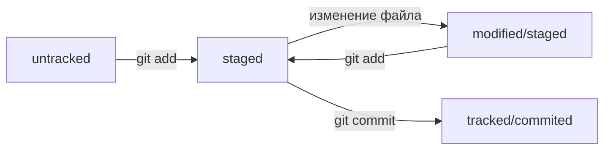

# Проверочная работа по Git №1

В данной проверочной работе я постарался записать и оформить свои заметки по урокам, прошедшим до проверочной работы.

---

## Основные понятия

* **VCS/SCM** - система контроля версий(ревизий)/система управления исходным кодом. Git является одной из данных систем.
* **Git Bash** - консольный инструмент для работы с Git.
* **GUI** - графический интерфейс.
* **Командная строка/CLI** - текстовый интерфейс.
* **Директория** - путь к папке. Папка = директория, грубо говоря.
* **Домашняя директория** - путь к каталогу (папке) с файлами пользователя.
* **Репозиторий** - это место хранения кода и всей истории его изменений.
* **Коммит** - фиксация изменений в Git.
* **Хеш коммита** - основной и уникальный идентификатор коммита.
* **GitHub** - платформа для размещения удалённых репозиториев и взаимодействия с ними.
* **SSH-ключи** - ключи безопасности для обмена данными.
* **Маркдаун** - специальный язык для разметки текста. Используется для разметки текста в файле README.md.
* **HEAD** - один из служебных файлов папки ```.git```. Указывает на последний коммит. Если нужно передать последний коммит, то вместо его хеша можно просто написать ```HEAD```.
* **Staging area** - список файлов, подготовленных к коммиту с помощью команды ```git add```.
* **Схема типа ```mermaid```** - описание схемы в текстовом формате, который GitHub превращает в полноценную схему с блоками и стрелками.

---

## Консольные команды Bash для работы с файлами и папками

*Можно выполнять последовательность нескольких команд. Для этого необходимо разделить команды с помощью "&&". С помощью стрелки вверх можно вызвать последнюю использованную команду, с помощью стрелки вниз - вернуться обратно. Повторение неограничено, с момента текущей сессии. Если ввести часть команды/пути (или даже одну букву) и дважды нажать Tab, то отобразятся все команды/пути, начинающиеся на введённые символы.*

* ```pwd``` - вывод текущего пути (пути к папке в которой вы находитесь).
* ```cd "наименование необходимой папки"``` - переход в конкретную папку. Также возможен переход через несколько директорий. В таком случае директории разделяются знаком "/"
1. Если вместо необходимой папки написать символ "~", то осуществится переход в домашнюю директорию.
2. Если в наименовании папки присутствуют пробелы, то наименование указывается в кавычках.
3. Если вместо папки написать "..", то осуществится переход в родительскую папку (на уровень вверх).
4. Если вместо папки ввести ".", то осуществится обращение к текущей директории. *Используется редко. К примеру, для запуска скриптов, который принимают папку в качестве параметра*.

_**В дальнейшем, стоит уточнить, что большая часть описанных команд (или даже все) работает с флагами, родительскими директориями, домашней директорией, структурой директорий и т.д. Не будем заново уточнять, чтобы не нагромождать текст**_

* ```ls``` - вывод всех (почти) файлов и папок в текущей директории. При добавлении ключа ```-a``` выводятся все файлы и папки, в том числе скрытые и начинающиеся с точки.
* ```touch "наименование файла"``` - создание файла. После имени файла также можно добавить расширение файла, к примеру, ".txt". Также можно создать несколько файлов. Для этого необходимо указать их через пробел.
* ```mkdir "наименование папки"``` - создание директории. Возможно создание структуры директорий. Для этого необходимо добавить флаг ```-p``` и через "/" указать структуру.
* ```cp "наименование файла/папки, которые копируем" "наименование директории, куда копируем"``` - копирование файла/папки в указанную директорию. Также возможно копирование нескольких файлов/папок, для этого необходимо указать их через пробел.
* ```mv "что перемещаем" "куда перемещаем"``` - перемещение файлов/папок в указанную директорию. Возможности аналогичны таковым у команды ```cp```.
* ```cat "наименование файла"``` - чтение текстового файла.
* ```rmdir "наименования директории"``` - удаление указанной директории. Этой командой возможно удаление лишь тех папок, в которых нет файлов (но могут быть другие папки).
* ```rm "наименование файла"``` - удаление указанного файла. Если добавить к этой команде флаг ```-r```, то появится возможность удалить папку, даже если в ней есть файлы - **ОПАСНО. УДАЛЕНИЕ НЕОБРАТИМО. ИСПОЛЬЗОВАТЬ С ОСТОРОЖНОСТЬЮ**.

## Консольные команды для работы с коммитами, пушами и настройками Git

* ```git config --global``` - установка глобальных настроек Git. Для имени пользователя используйте ```user.name```, а для email - ```user.email```.

*Все глобальные настройки хранятся в файле .gitconfig в домашней директории*

* ```git config --list``` - чтение файла текущей конфигурации Git.
* ```git init``` - инициализация репозитория. Инициализируется та папка, в которой вы сейчас находитесь.
* ```rm -rf .git``` - "разгитить" текущую папку.
* ```git status``` - проверка текущего состояния репозитория.
* ```git add "наименования файла/папки"``` - подготовка к сохранению указанных файлов/папок. Если вместо наименования добавить флаг ```--all``` то будут подготовлены все файлы и папки в текущей директории.
* ```git commit -m "Сообщение для этого коммита"``` - коммит изменений и сохранением сообщения для него.
* ```git log``` - просмотр коммитов текущего репозитория. Коммиты отображаются в обратном порядке.
* ```ls -la .ssh``` - просмотр SSH-ключей в текущей директории.
* ```ssh-keygen -t ed25519 -C "электронная почта, к которой привязан ваш аккаунт на GitHub"``` - генерация SSH-ключей в алгоритме шифрования **ed25519**.
* ```git remote add "имя удалённого репозитория" "URL удалённого репозитория"``` - привязка удалённого репозитория к локальному. Необходимо запускать из инициализированного локального репозитория.
* ```git remote -v``` - просмотр связки локального и удалённого репозиториев.
* ```git push -u origin master``` - отправить изменения на удалённый репозиторий.
* ```git log --oneline``` - получение первых нескольких сиволов хешей каждого коммита и их комментарии.
* ```git commit --amend``` - добавление файлов к последнему коммиту. Перед этим необходимо отправить необходимые файлы в staging area. При добавлении опции ```--no-edit``` не меняется сообщение коммита. При добавлении ключа ```-m``` с сообщением - изменяется сообщение коммита. _Следует обратить внимание, что хеш коммита также меняется._

---

## Статусы файлов в Git.

* ```untracked``` - **Неотслеживаемый**. Git видит данный файл, но не следит за изменениями в нём, так как он не подготовлен командой ```git add``` и у него нет предыдущих версий.
* ```tracked``` - **Отслеживаемый**. Файлы, которые уже были закоммичены или подготовлены к коммиту.
* ```staged``` - **Подготовленный**. Файлы, подготовленные командой ```git add``` к коммиту. 
* ```modified``` - **Изменённый**. Файлы, которые отличаются от своей последней закоммиченой версии.

---

## Жизненный цикл файла в Git.

1. Файл только что создали. Git ещё не отслеживает содержимое этого файла. Состояние: ```untracked```.
2. Файл добавили в staging area. Состояние: ```staged```, ```modified``` (+ ```tracked```, по умолчанию). ```staged``` и ```modified``` могут быть у одного файла, но у разных его версий. Допустим, добавили в staging area, а затем, до коммита, изменили файл. Если опять воспользоваться командой ```git add```, то статус будет изменён на ```staged``` (+ ```tracked```).
3. Коммит изменений с помощью ```git commit```. Состояние: ```tracked```.
4. Изменение файла. Состояние: ```modified``` (+ ```tracked```).
5. Повторное добавление файла в staging area. Статус: ```staged``` (+ ```tracked```).
6. Снова сделан коммит. Состояние: ```tracked```.
7. Повторять до готовности шаги 4-6.


	

---


## Небольшие инструкции для основных моментов работы с репозиториями

### Инициализация репозитория

1. Создайте новую папку под проект - ```mkdir```.
2. Откройте терминал внутри этой папки - ```cd```.
3. Выполните команду ```git init```.
4. Настройте пользователя, если ещё не сделано с помощью команды ```git config --global```.
5. Создайте или скопируйте файлы проекта в эту папку.
6. Подготовьте файлы к сохранению - ```git add```.
7. Закоммитьте изменения - ```git commit -m "Сообщение для этого коммита"```.

### Генерация и привязка SSH-ключей

1. Выполните в команду ```ssh-keygen -t ed25519 -C "ваш_email@example.com"```
2. При запросе пути сохранения нажмите Enter (по умолчанию). При запросе пароля можно оставить пустым (Enter), чтобы не вводить его при каждом пуше.
3. Выполните команду ```cat ~/.ssh/id_ed25519.pub``` для получения публичного ключа. Скопируйте ключ.
4. В GitHub зайдите в Settings -> SSH and GPG keys. Нажмите "New SSH key". Вставьте скопированный текст в поле Key, дайте название и сохраните.
5. Выполните ```ssh -T git@github.com```. Увидите приветствие - ключ работает.

### Связывание локального и удалённого репозиториев

1. Убедитесь, что вы находитесь в папке с уже инициализированным локальным репозиторием.
2. На GitHub создайте новый репозиторий. Скопируйте SSH-адрес репозитория.
3. Выполните команду ```git remote add origin "скопированный SSH-адрес"```.
4. Выполните команду ```git remote -v```. Вы должны увидеть две строки - fetch и push с вашим URL.

### Синхронизация локального и удалённого репозиториев

1. Выполните команду ```git status```. Ответ должен быть "чистым". Если нет, то закоммитьте изменения.
2. Выполните ```git push -u origin "master"```. Флаг ```-u``` запомнит связь, чтобы в будущем писать просто ```git push```.
3. Для последующих синхронизаций выполняйте последовательность команд ```git``` - ```add```, ```commit -m```, ```push```.